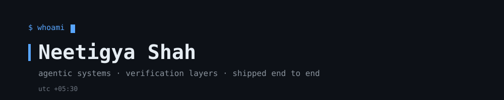

<!--
  README.md — Neetigya Shah
  Profile: github.com/NeetigyaShah
-->

<p align="center">
  
</p>

<p align="center">
  <code>agentic systems · verification layers · shipped end to end</code>
</p>

<p align="center">
  <a href="https://linkedin.com/in/neetigya-shah-6277b9245">linkedin</a>
  · <a href="mailto:neetigyashah@gmail.com">email</a>
  · <a href="https://neetigya.vercel.app">portfolio</a>
</p>

<br/>

## `$ cat profile.json`

```json
{
  "now":     "building agentic tooling + upstream fixes in the OSS I run daily",
  "focus":   "LLM agents that are verified, not trusted — generate → independently verify → confidence-gate",
  "craft":   "full ownership, pipeline to UI: data → agent/model → API → interface",
  "design":  "constraints that survive production — offline fallbacks, CPU-only budgets, zero-API-key demos",
  "school":  "B.Tech CSE @ Vellore Institute of Technology (2022–2026)",
  "contact": "neetigyashah@gmail.com"
}
```

<br/>

## `$ gh repo list --featured`

<table>
  <tr>
    <td width="50%" valign="top">
      <h3><a href="https://github.com/NeetigyaShah/BugReel">BugReel</a></h3>
      <p><b>Bug reports that actually explain the bug</b></p>
      <p>A &lt;4KB loader watches a rolling ~60s buffer of clicks, routes, network calls, and console output inside a Web Worker. Deterministic detectors catch the three failures humans can't describe — dead clicks, silent failures, rage clicks — and compile everything into a self-contained <code>.bugpack</code>: annotated screenshot, replayable <code>curl</code>, runnable Playwright repro. No AI, no session replay, nothing leaves the page until submit.</p>
      <p><code>TypeScript</code> <code>pnpm monorepo</code> <code>Web Worker</code> <code>Playwright</code> — 373 unit + 26 e2e tests · published as <code>@bugreel/sdk</code></p>
    </td>
    <td width="50%" valign="top">
      <h3><a href="https://github.com/NeetigyaShah/docguard">DocGuard</a></h3>
      <p><b>Self-healing documentation CI bot</b></p>
      <p>Watches a <code>git diff</code> and finds which code changes actually made your Markdown stale — AST-level, not text diff. One LLM writes the fix, an <b>independent second LLM validates it</b> before it reaches you: confidence-gated auto-PR, review comment, or report-only. Runs fully offline via a deterministic mock oracle — zero API key to demo.</p>
      <p><code>Python</code> <code>tree-sitter</code> <code>Docker Action</code> <code>React</code> — 106 tests · ships as a GitHub Action</p>
    </td>
  </tr>
  <tr>
    <td width="50%" valign="top">
      <h3><a href="https://github.com/NeetigyaShah/frisk-risk-signal-aggregator">frisk</a></h3>
      <p><b>Agentic AML risk-triage engine</b></p>
      <p>A tool-calling LLM agent that investigates a customer dossier the way a human analyst would: pulls signals, builds a <b>cited</b> investigation trace, scores risk instead of returning a black-box number. 5-tier Redis memory + a human-review queue so analyst overrides actually get learned from. Fully offline against mock data.</p>
      <p><code>Python</code> <code>LangGraph</code> <code>Redis</code> <code>Human-in-the-loop</code></p>
    </td>
    <td width="50%" valign="top">
      <h3><a href="https://github.com/NeetigyaShah/deep-research">deep-research</a></h3>
      <p><b>Deep research agent that lives inside your AI coding tool</b></p>
      <p>Type <code>/deep-research</code> + a topic. It interviews you first — never guesses — turns your answers into explicit goals, then fans parallel sub-agents across web and academic papers (reads real arXiv sections, not just abstracts), loops until every goal meets its done-criteria, and ships a white-paper HTML report with a Gaps section instead of made-up answers. Progress lives in Markdown, so an interrupted run resumes.</p>
      <p><code>AI skill</code> <code>parallel sub-agents</code> <code>arXiv</code> <code>DuckDuckGo</code></p>
    </td>
  </tr>
</table>

<br/>

## `$ gh pr list --author @me --not-owner @me`

Contributions outside my own repos — mostly <a href="https://github.com/can1357/oh-my-pi">oh-my-pi</a>, the coding agent I build on daily:

| # | Type | State | What |
|---|------|-------|------|
| <a href="https://github.com/can1357/oh-my-pi/pull/12325">12325</a> | PR | 🟣 open | OAuth device flow + client-identity headers + workspace routing for zen console |
| <a href="https://github.com/can1357/oh-my-pi/pull/10891">10891</a> | PR | 🟣 open | Per-provider API key lists with cycling and failover |
| <a href="https://github.com/can1357/oh-my-pi/pull/10870">10870</a> | PR | 🟣 open | Cap vercel muse-spark-1.3-contributor output tokens |
| <a href="https://github.com/can1357/oh-my-pi/pull/10866">10866</a> | PR | ✅ merged | Guard gradient palette against uninitialized global theme |
| <a href="https://github.com/cgarrot/pi-voice-stt/pull/19">pi-voice-stt#19</a> | PR | ✅ merged | Fix 0-byte ffmpeg capture on Windows, TUI editor proxy, debounced toggle |
| <a href="https://github.com/can1357/oh-my-pi/issues/10871">10871</a> | Issue | 🟢 open | Option to cycle API keys for API-key-auth providers |
| <a href="https://github.com/can1357/oh-my-pi/issues/10864">10864</a> | Issue | ⚪ closed | `theme.getColorMode` crash in gradient-highlight palette |
| <a href="https://github.com/can1357/oh-my-pi/issues/12306">12306</a> | Issue | 🟢 open | muse-spark-1.3-contributor-free 403 FreeTierError (also commented) |

<br/>

## `$ gh api /users/NeetigyaShah --jq .stats`

```
commits (all repos)      655
external PRs             6 (2 merged, 3 open)
external issues          3 filed
public repos             26
```

<p align="center">
  
</p>

<p align="center">
  
</p>

<br/>

## `$ which --all tools`

<p align="center">
  
</p>

<br/>

<p align="center">
  <code>open to agentic-AI / backend / full-stack roles — neetigyashah@gmail.com</code>
</p>
